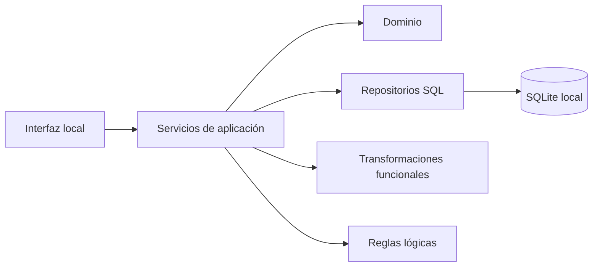
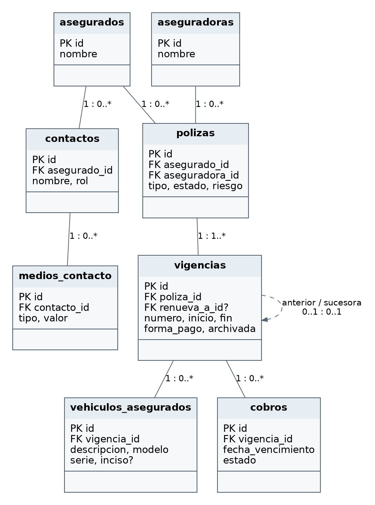

# Urdiales Asesores · Clientes y pólizas

Base del proyecto integrador de **Alfa Consultora**, desarrollado para centralizar los registros de clientes y pólizas de **Urdiales Asesores**.

**Estado: esqueleto inicial, no sistema terminado.** Incluye organización modular, configuración TOML, un esquema SQLite propuesto, inicialización de una base vacía, una ventana de arranque y pruebas de esa infraestructura. La captura, edición, filtros, atención por fechas e histórico todavía requieren implementación.

## Problema y objetivo

La empresa organiza información en Excel y utiliza un calendario para fechas de renovación y cobranza. Buscar por asegurado, aseguradora o fecha consume tiempo.

El objetivo es concentrar la información en una aplicación local pequeña, facilitar las consultas y distinguir las vigencias actuales de las anteriores o vencidas. El seguimiento se refiere al almacenamiento y consulta de registros, fechas y estados.

## Alcance previsto

- Clientes o asegurados con varias pólizas y contactos opcionales.
- Pólizas de autos y daños; vehículos individuales e incisos de flotillas.
- Registro de número de póliza, vigencia y forma de pago por periodo.
- Filtros combinables por asegurado, aseguradora, fechas y renovación o cobranza.
- Fechas más próximas primero y resalte de casos que requieren atención.
- Anticipación de 30 días en los casos que se validen con la empresa.
- Nueva vigencia al renovar, conservando la anterior en el histórico.
- Registro manual de cobros y sus estados propuestos: pendiente y pagado.

Las comunicaciones con clientes, campañas, generación de cotizaciones, gráficas y reportes comerciales quedan fuera del alcance acordado. También se excluyen la importación de Excel desde la interfaz, la exportación a Excel y las funciones de respaldo y restauración de la base de datos.

Se conservan **11 requerimientos funcionales y 5 no funcionales**. La guía pide al menos 10 funcionales y 5 no funcionales; no hace falta sustituir la exportación con otra función.

**Pendiente académico:** conciliar con el docente la carga/limpieza de archivos y los indicadores que exige la guía. Las exclusiones comerciales no implican una excepción aprobada de la rúbrica.

Consulta el [alcance detallado](docs/alcance.md), los [pendientes](docs/pendientes.md) y los [entregables académicos](docs/entregables.md).

## Qué funciona ahora

| Componente | Situación |
| --- | --- |
| Configuración TOML | Lectura, validación y resolución de rutas relativas |
| Diagnóstico sin pantalla | Comprueba el esquema en memoria sin crear una base local |
| SQLite | Creación explícita de ocho tablas y restricciones del diseño propuesto |
| Base ya inicializada | Conserva registros de esta versión; rechaza otros esquemas y versiones |
| Ventana inicial | Abre tres pestañas informativas; aún no captura ni consulta datos |
| Documentación de diseño | Diagramas editables, imágenes, matriz y documento Word |
| Pruebas | Nueve pruebas de infraestructura; no constituyen aceptación de la solución |
| Casos de uso del negocio | Pendientes; los módulos están reservados para desarrollarlos |

El esquema incorpora supuestos por validar. Aún no hay migraciones de base de datos, datos de demostración ni evidencia completa de los seis paradigmas.

## Requisitos

- Python **3.11 o posterior**, con los módulos estándar `sqlite3` y `tomllib`.
- Tkinter para abrir la ventana; el diagnóstico y las pruebas pueden ejecutarse sin pantalla ni Tkinter.
- Git para colaborar. GitHub CLI es opcional para el equipo.

El arranque actual no necesita instalar bibliotecas con `pip` ni tener Excel o un servidor de base de datos. Algunas distribuciones de Linux distribuyen Tkinter por separado en el paquete `python3-tk`.

## Inicio rápido

Desde la carpeta del repositorio:

```bash
python3 main.py --comprobar
python3 main.py
```

En Windows se puede usar `py -3.11` o el comando `python` correspondiente a una instalación 3.11 o posterior. Ejecuta los comandos desde la raíz del repositorio.

La primera orden valida la configuración y el esquema en memoria. La segunda abre la ventana inicial. Ninguna de esas dos órdenes crea ni carga una base de clientes.

Para personalizar la configuración, copia el archivo de ejemplo:

```bash
cp config.example.toml config.toml
```

En PowerShell:

```powershell
Copy-Item config.example.toml config.toml
```

`config.toml` está excluido de Git. Si no existe, se usa `config.example.toml` de la carpeta actual.

### Crear la base vacía

```bash
python3 main.py --inicializar-bd
```

La ruta predeterminada es `datos_locales/urdiales.sqlite3`. La inicialización conserva una base ya creada con las tablas y versión esperadas. No borra registros ni migra otra base; ante un esquema diferente devuelve un error.

Para usar otro archivo de configuración:

```bash
python3 main.py --config ruta/a/config.toml --comprobar
python3 main.py --config ruta/a/config.toml --inicializar-bd
```

La ruta de SQLite se resuelve respecto a la carpeta del archivo TOML, aunque ejecutes la orden desde otra ubicación.

### Entorno virtual opcional

La base actual solo usa la biblioteca estándar. Si preparas un entorno aislado:

```bash
python3 -m venv .venv
source .venv/bin/activate
python main.py --comprobar
```

En Windows, la activación es `.venv\Scripts\Activate.ps1`. El archivo `pyproject.toml` prepara la futura instalación del paquete y la inclusión de su esquema SQL.

## Estructura

```text
urdiales-polizas/
├── main.py                         # Entrada desde el repositorio
├── pyproject.toml                  # Metadatos y empaquetado Python
├── config.example.toml             # Configuración compartible
├── src/urdiales_polizas/
│   ├── __main__.py                 # Opciones de arranque
│   ├── configuracion.py            # Lectura de TOML
│   ├── dominio/
│   │   ├── clientes.py             # Futuras entidades y contactos
│   │   ├── polizas.py              # Futuras pólizas, vigencias y vehículos
│   │   └── cobros.py               # Futura entidad de cobro
│   ├── aplicacion/servicios.py     # Futura coordinación de casos de uso
│   ├── persistencia/
│   │   ├── base_datos.py           # Conexión e inicialización SQLite
│   │   ├── esquema.sql             # Esquema propuesto de ocho tablas
│   │   └── repositorios.py         # Futuros accesos parametrizados
│   ├── consultas/transformaciones.py # Futuras funciones puras
│   ├── reglas/atencion.py          # Futuras consultas lógicas de fechas
│   ├── interfaz/ventana_principal.py # Ventana inicial Tkinter
│   └── datos/carga_demo.py         # Futura carga de registros sintéticos
├── tests/                          # Pruebas con unittest
├── docs/
│   ├── alcance.md
│   ├── pendientes.md
│   ├── entregables.md
│   └── diseno/                     # Word, UML, imágenes y trazabilidad
├── datos_locales/                  # SQLite local, excluido de Git
└── .github/workflows/              # Comprobación automática
```

Los archivos reservados describen su responsabilidad en una cadena de documentación; todavía no contienen las entidades ni las operaciones del negocio.

## Arquitectura propuesta



La interfaz coordinará la captura y presentación; los servicios coordinarán los casos de uso; el dominio contendrá las reglas del negocio y los repositorios accederán a SQLite. Esta separación es el destino del diseño, no una afirmación de que esas conexiones ya funcionan.

Para el proyecto académico se reservan espacios para programación imperativa, estructurada, orientada a objetos, declarativa, funcional y lógica. La [distribución y evidencia pendiente](docs/entregables.md#distribución-propuesta-de-paradigmas) debe actualizarse conforme exista código comprobable.

## Modelo de datos propuesto

Ocho tablas: `asegurados`, `contactos`, `medios_contacto`, `aseguradoras`, `polizas`, `vigencias`, `vehiculos_asegurados` y `cobros`.

Un asegurado puede tener varias pólizas; cada póliza conserva sus vigencias y cada vigencia sus vehículos o incisos y cobros. El número de póliza pertenece a la vigencia para conservar los cambios entre renovaciones.

Los identificadores alfanuméricos y teléfonos se guardan como texto. Las fechas usan el formato completo `AAAA-MM-DD`. R, C y las marcas del Excel corresponden al proceso actual; no se replican literalmente como estados.



## Pruebas

```bash
python3 -m unittest discover -s tests -t . -v
```

Las pruebas comprueban rutas de configuración, rechazo de valores inválidos, creación del esquema, claves foráneas, conservación de registros al reinicializar y errores de arranque. Usan memoria o carpetas temporales con datos ficticios.

La automatización de GitHub ejecuta estas pruebas y el diagnóstico con Python 3.11 y 3.12. No abre la ventana gráfica. La captura, filtros, relaciones del negocio, renovación transaccional, edición y persistencia de los futuros casos de uso necesitan sus propias pruebas al implementarse.

## Documentación y entregas

- [Índice de análisis y diseños](docs/diseno/README.md).
- [Documento de diseños en Word](docs/diseno/Disenos_Urdiales_v1.docx).
- [Fuentes editables UML](docs/diseno/uml/).
- [Matriz de trazabilidad](docs/diseno/Matriz_Trazabilidad.csv).
- [Guía de contribución y commits](CONTRIBUTING.md).
- [Entregables E1–E4](docs/entregables.md).

E2 reúne análisis y diseño; después se integra en el capítulo correspondiente del informe técnico final. El código en GitHub complementa el paquete que exige la guía, incluidos informe, UML editable, manual, presentación y video.

## Manejo de información

Este repositorio debe contener código, documentación académica y ejemplos sintéticos. Las bases locales, respaldos, exportaciones, configuración personal y archivos de clientes quedan excluidos de Git. Las cartas firmadas y minutas con información sensible deben conservarse en el espacio privado de documentación del equipo.

## Equipo

**Alfa Consultora · Universidad Regiomontana**

- Josue Abel Villegas Garcia
- Scarlett Alvarado Urdiales
- Emiliano Ramirez Gonzalez
- David Alejandro Carrillo Cázares

Docente: Azael Adan Gutierrez Castruita. Organización de referencia: Urdiales Asesores.
